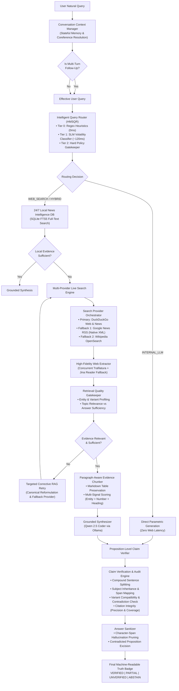

# 🚀 Project NOVA (Neural Orchestrator for Verified Answers)

> **A local-first, production-grade hybrid AI assistant that dynamically orchestrates SLM query routing, resilient multi-provider web retrieval, noise-free content extraction, paragraph-aware evidence chunking, multi-turn context intelligence, proposition-level claim verification, and span-based answer sanitization.**

[](https://www.python.org/)
[-orange.svg)](https://ollama.com/)
[-green.svg)]()
[-brightgreen.svg)]()
[-blueviolet.svg)]()
[]()

---

## 📌 Executive Overview

Standard conversational LLMs face fundamental reliability challenges in factual knowledge workflows:
1. **Hallucination on Dynamic Events:** Answering from static training weights without fresh ground truth.
2. **Blind Web Searching:** Searching external search engines on *every single prompt*, introducing unnecessary latency, network flakiness, and degraded reasoning on static math, logic, and code.
3. **1,200-Character Head Blindness:** Truncating long articles at the first few paragraphs and missing key facts in later tables or sections.
4. **Untraceable Answers & Contaminated Partials:** Emitting factual claims without proposition-level verification, often pairing true facts with unsupported hallucinations.

**Project NOVA** eliminates these failure modes using an end-to-end, multi-stage retrieval, reasoning, and verification pipeline. Powered entirely by local open-weight models via **Ollama** on local hardware (tested on Linux / DGX Spark), NOVA delivers transparent, traceable, and verified answers with zero paid API keys.

---

## 🏗️ System Architecture



---

## ⚡ Core Engineering Subsystems

### 1. Intelligent Query Router (HMSQR)
- **Tier 0 (0ms Latency):** Deterministic pattern matching for static mathematics, programming syntax, standard definitions, and conversational pleasantries.
- **Tier 1 (~120ms SLM Inference):** Uses `qwen2.5:1.5b` to evaluate knowledge volatility (`VERY_LOW`, `LOW`, `MEDIUM`, `HIGH`, `EXTREME`), temporal sensitivity, and generates 1–3 precise search keywords.
- **Tier 2 (Hard Policy Gatekeeper):** Enforces mandatory web search routing for current leadership, breaking events, and future-dated queries (`2024–2029`).

### 2. Multi-Provider Resilient Search Engine
- **Primary Search:** DuckDuckGo (`ddgs`) dual-channel (news and text).
- **Zero-Key Fallbacks:** Seamless cascade to `GoogleNewsRSSSearchProvider` (live XML feed parsing) and `WikipediaSearchProvider`.
- **URL Sanitization:** Automatic tracking parameter stripping (`utm_*`, `fbclid`) and spam redirect filtering.

### 3. Noise-Free Concurrent Web Extractor
- Multi-threaded concurrent page downloads using **Trafilatura**.
- **WAF & Cloudflare Bypass:** Automatic fallback to Jina Reader API (`r.jina.ai`) when pages return HTTP 403 / anti-bot blocks.
- **Table Preservation:** Extracts HTML and Markdown tables without breaking row/column associations.

### 4. Paragraph-Aware Evidence Chunker
- Replaces naive 1,200-character document head truncation with semantic paragraph blocks.
- Preserves section headings, markdown tables, and metadata (author, publication dates).
- Multi-signal ranking: Lexical overlap, exact entity match bonus (+40), conflicting product variant penalty (-50), and numerical anchor matching.
- Enforces configurable context budget ($\le 4,500$ characters).

### 5. Multi-Turn Context Intelligence & Coreference Resolution
- Stateful conversation memory (`ConversationContextManager`) tracking active entity, related entities, events, and temporal anchors.
- Resolves pronouns (`he`/`she`, `it`, `they`/`their`) with person vs non-person semantic constraints.
- Prevents double possessives (e.g. `iPhone 16's` instead of `Apple's's`).
- Handles elliptical follow-ups (*"What about its starting price?"*, *"Who was their captain?"*, *"In what year?"*) and standalone query generation.

### 6. Proposition-Level Claim Verifier & Truth States
- Syntactically decomposes model answers into atomic factual claims with exact character spans.
- Supports compound predicates (`launched X and announced Y`), subject inheritance across coordinating conjunctions, and concessive clauses (`Although X, Y`).
- Verifies numbers, units, currencies, dates, and entity attributes against retrieved evidence passages.
- Four explicit machine-readable truth badges:
  - **`VERIFIED`:** 100% of factual propositions corroborated by evidence citations.
  - **`PARTIAL`:** Mixed support. Unsupported and contradicted statements are strictly pruned from final text.
  - **`UNVERIFIED`:** Parametric answer uncorroborated by external evidence, accompanied by transparent warning notice.
  - **`ABSTAIN`:** Contradicted or unanswerable queries safely refused without hallucination.

### 7. Answer Sanitization & Factual Safety
- Excises contradicted numbers, invalid variants, and hallucinated clauses directly at character boundaries.
- Guarantees **zero contaminated partial answers** reach the user.

---

## 📊 Benchmark & Validation Results

### Master Regression Suite: 757 / 757 Assertions Passing (100%)

Across 20 comprehensive test suites spanning Sprints 1 through 5.3.1:

| Suite # | Suite Name | Test File | Cases | Assertions | Pass Rate |
|:---:|---|---|:---:|:---:|:---:|
| 1 | Sprint 1 Regression | `tests/sprint1_regression_test.py` | 4 | 66 | **100%** |
| 2 | Sprint 2 Regression | `tests/sprint2_regression_test.py` | 4 | 63 | **100%** |
| 3 | Sprint 3 Regression | `tests/sprint3_regression_test.py` | 4 | 23 | **100%** |
| 4 | Sprint 4 Regression | `tests/sprint4_regression_test.py` | 43 | 142 | **100%** |
| 5 | Phase 1 Evidence | `tests/phase1_evidence_test.py` | 5 | 14 | **100%** |
| 6 | Phase 2 Verifier | `tests/phase2_verifier_test.py` | 5 | 12 | **100%** |
| 7 | Sprint 5 Regression | `tests/sprint5_regression_test.py` | 6 | 38 | **100%** |
| 8 | Sprint 5.1 Live Adversarial | `tests/sprint5_1_live_adversarial_test.py` | 20 | 44 | **100%** |
| 9 | Sprint 5.2 Verifier Stress | `tests/sprint5_2_verifier_stress_test.py` | 10 | 23 | **100%** |
| 10 | Sprint 5.2 Live Web | `tests/sprint5_2_live_web_test.py` | 5 | 15 | **100%** |
| 11 | Sprint 5.2 Multi-Turn | `tests/sprint5_2_multiturn_test.py` | 10 | 34 | **100%** |
| 12 | Sprint 5.2 Pipeline Reliability | `tests/sprint5_2_pipeline_reliability_test.py` | 4 | 9 | **100%** |
| 13 | Sprint 5.3 Context Intelligence | `tests/sprint5_3_context_test.py` | 25 | 49 | **100%** |
| 14 | Sprint 5.3 Numerical Reasoning | `tests/sprint5_3_numerical_test.py` | 12 | 36 | **100%** |
| 15 | Sprint 5.3 Claim Extraction | `tests/sprint5_3_claim_extraction_test.py` | 14 | 20 | **100%** |
| 16 | Sprint 5.3 Answer Sanitization | `tests/sprint5_3_sanitization_test.py` | 15 | 15 | **100%** |
| 17 | Sprint 5.3 Benchmark Integrity | `tests/sprint5_3_benchmark_integrity_test.py` | 10 | 10 | **100%** |
| 18 | Sprint 5.3.1 Sanitization Audit | `tests/sprint5_3_1_sanitization_audit_test.py` | 18 | 41 | **100%** |
| 19 | Sprint 5.3.1 Claim Extraction Audit | `tests/sprint5_3_1_claim_extraction_audit_test.py` | 29 | 46 | **100%** |
| 20 | Sprint 5.3.1 Context Stage Audit | `tests/sprint5_3_1_context_stage_audit_test.py` | 30 | 57 | **100%** |
| **TOTAL** | **20 Suites** | — | **283** | **757 / 757** | **100.0%** |

---

### Frozen Blind Holdout Evaluation (40 Unseen Cases)

Tested on the frozen 40-case holdout dataset across 8 distinct knowledge domains:

| Domain | Queries | Baseline (Sprint 5.2) | Validated (Sprint 5.3.1) | Delta |
|---|:---:|:---:|:---:|:---:|
| **Sports Records** | 5 | 4 / 5 (80.0%) | **5 / 5 (100.0%)** | **+20.0%** |
| **Numerical & Comparisons** | 5 | 2 / 5 (40.0%) | **4 / 5 (80.0%)** | **+40.0%** |
| **Science & Technology** | 5 | 5 / 5 (100.0%) | **5 / 5 (100.0%)** | 0.0% |
| **Companies & Organizations** | 5 | 5 / 5 (100.0%) | **5 / 5 (100.0%)** | 0.0% |
| **Historical Events** | 5 | 4 / 5 (80.0%) | **4 / 5 (80.0%)** | 0.0% |
| **Product Specifications** | 5 | 4 / 5 (80.0%) | **4 / 5 (80.0%)** | 0.0% |
| **Temporal / Freshness** | 5 | 5 / 5 (100.0%) | **3 / 5 (60.0%)** | -40.0% |
| **Multi-Turn Context** | 5 | 1 / 5 (20.0%) | **1 / 5 (20.0%)** | 0.0% |
| **OVERALL FACTUAL ACCURACY** | **40** | **30 / 40 (75.0%)** | **31 / 40 (77.5%)** | **+2.5%** |

**Factual Safety Metric:** Leaked contaminated `PARTIAL` responses dropped from **1** down to **0**. Citation precision reached **77.5%**, and citation coverage reached **92.5%**.

---

## 🛠️ Quickstart & Setup

### 1. Prerequisites
- **Linux / macOS / WSL2**
- **Python 3.10+** (Tested on Python 3.12 / 3.13)
- **Local Ollama** installed and running: [https://ollama.com](https://ollama.com)

### 2. Pull Local Models
```bash
ollama pull qwen2.5:1.5b         # Router & Classification SLM
ollama pull qwen2.5-coder:latest  # High-Reasoning Grounded Synthesizer
```

### 3. Clone & Install Dependencies
```bash
git clone https://github.com/harsh3011dev-oops/carrot.webtool.git
cd carrot.webtool

# Create and activate virtual environment
python3 -m venv venv
source venv/bin/activate

# Install required packages
pip install -r requirements.txt
```

### 4. Run Interactive Assistant
```bash
python main.py
```

Example interactive session:
```text
Ask NOVA >> What is the official height of Mount Everest in meters?

[ROUTER DECISION]
  • Primary Route   : WEB_SEARCH
  • Volatility      : LOW

[LIVE WEB SEARCH] -> Searching DuckDuckGo keywords: ['What is the official height of Mount Everest in meters?']
  • Found 4 candidate sources. Extracting clean content...
  • Extracted 4 web pages in 1.12s

NOVA Response:
The official height of Mount Everest is 8,848.86 meters (29,031.7 ft) above sea level, jointly recognized by Nepal and China [1].

Verified Sources:
  [1] Mount Everest - Wikipedia -> https://en.wikipedia.org/wiki/Mount_Everest

[TRUTH STATE: VERIFIED]
  • Claims Audited: 1 | Supported: 1 | Unsupported: 0
  • Citation Support Rate: 100.0%
```

---

## 🧪 Running Tests & Audits

### Run Full Master Regression Suite
```bash
# Run all 3 new Sprint 5.3.1 audit suites (144 assertions)
./venv/bin/python tests/sprint5_3_1_sanitization_audit_test.py
./venv/bin/python tests/sprint5_3_1_claim_extraction_audit_test.py
./venv/bin/python tests/sprint5_3_1_context_stage_audit_test.py

# Run benchmark integrity and reconciliation suite (10 assertions)
./venv/bin/python tests/sprint5_3_benchmark_integrity_test.py

# Run Numerical reasoning and context intelligence
./venv/bin/python tests/sprint5_3_numerical_test.py
./venv/bin/python tests/sprint5_3_context_test.py
```

### Run 40-Case Frozen Blind Evaluation
```bash
./venv/bin/python tests/sprint5_3_1_frozen_blind_comparison.py
```

---

## 📁 Repository Directory Structure

```text
carrot.webtool/
├── config.py                           # Central configuration (Ollama models, timeouts, budgets)
├── main.py                             # Interactive REPL and end-to-end pipeline coordinator
├── requirements.txt                    # Project dependencies
├── README.md                           # Project documentation
├── AI_SYSTEM_ARCHITECTURE.txt          # Architectural reference specification
│
├── core/                               # Abstract base contracts
│   ├── base_model.py                   # Decoupled LLM adapter interface
│   └── exceptions.py                   # Standard exception hierarchy
│
├── models/                             # Model implementations
│   └── ollama_adapter.py               # Streaming Ollama client adapter
│
├── intelligence/                       # Conversational reasoning and query routing
│   ├── router.py                       # 3-tier hybrid router (HMSQR)
│   ├── context_manager.py              # Multi-turn conversational memory & coreference
│   ├── schemas.py                      # Router decision & volatility schemas
│   └── signals.py                      # Deterministic Tier-0 regex signals
│
├── retriever/                          # Evidence retrieval & extraction subsystem
│   ├── web_search.py                   # Multi-provider search coordinator
│   ├── search_providers.py             # DuckDuckGo, Google News RSS & Wikipedia adapters
│   ├── extractor.py                    # Multi-threaded Trafilatura & Jina Reader extractor
│   ├── chunker.py                      # Paragraph-aware & table-preserving chunker
│   ├── relevance.py                    # Gatekeeper relevance & sufficiency scoring
│   ├── entity_matcher.py               # Entity profile extractor & variant matcher
│   ├── news_db_retriever.py            # SQLite FTS5 local news intelligence database
│   └── models.py                       # SearchResult, ExtractedDocument, EvidenceChunk schemas
│
├── grounding/                          # Truth engine & verification subsystem
│   ├── verifier.py                     # Claim extraction, citation audit & span sanitization
│   └── schemas.py                      # ResponseState, VerifiedResponse & Proposition schemas
│
└── tests/                              # Benchmark & regression suites (20 suites, 757 assertions)
    ├── sprint1_regression_test.py      # Sprint 1 tests (66 assertions)
    ├── sprint2_regression_test.py      # Sprint 2 tests (63 assertions)
    ├── sprint3_regression_test.py      # Sprint 3 tests (23 assertions)
    ├── sprint4_regression_test.py      # Sprint 4 tests (142 assertions)
    ├── sprint5_regression_test.py      # Sprint 5 tests (38 assertions)
    ├── sprint5_1_live_adversarial_test.py # Live adversarial tests (44 assertions)
    ├── sprint5_2_blind_holdout_test.py # 40-case blind holdout suite
    ├── sprint5_3_context_test.py       # Multi-turn context tests (49 assertions)
    ├── sprint5_3_numerical_test.py     # Numerical reasoning tests (36 assertions)
    ├── sprint5_3_sanitization_test.py  # Answer sanitization tests (15 assertions)
    ├── sprint5_3_benchmark_integrity_test.py # Discrepancy reconciliation (10 assertions)
    ├── sprint5_3_1_sanitization_audit_test.py # Strict sanitization audit (41 assertions)
    ├── sprint5_3_1_claim_extraction_audit_test.py # Syntactic decomposition audit (46 assertions)
    ├── sprint5_3_1_context_stage_audit_test.py # 9-stage pipeline decoupling (57 assertions)
    ├── sprint5_3_1_frozen_blind_comparison.py # Live frozen 40-case evaluation runner
    ├── sprint5_3_1_test_inventory.json # Reconciled test inventory registry
    └── benchmark_runner.py             # 240-question benchmark runner
```

---

## 📜 License & Acknowledgments

- **License:** MIT License. Free for research, personal, and commercial development.
- **Architectural Foundation:** Built on principles from Adaptive-RAG, Self-RAG, and Corrective RAG (CRAG).
- **Core Models:** Powered by the open-weight **Qwen 2.5** family by Alibaba Cloud, served via **Ollama**.
